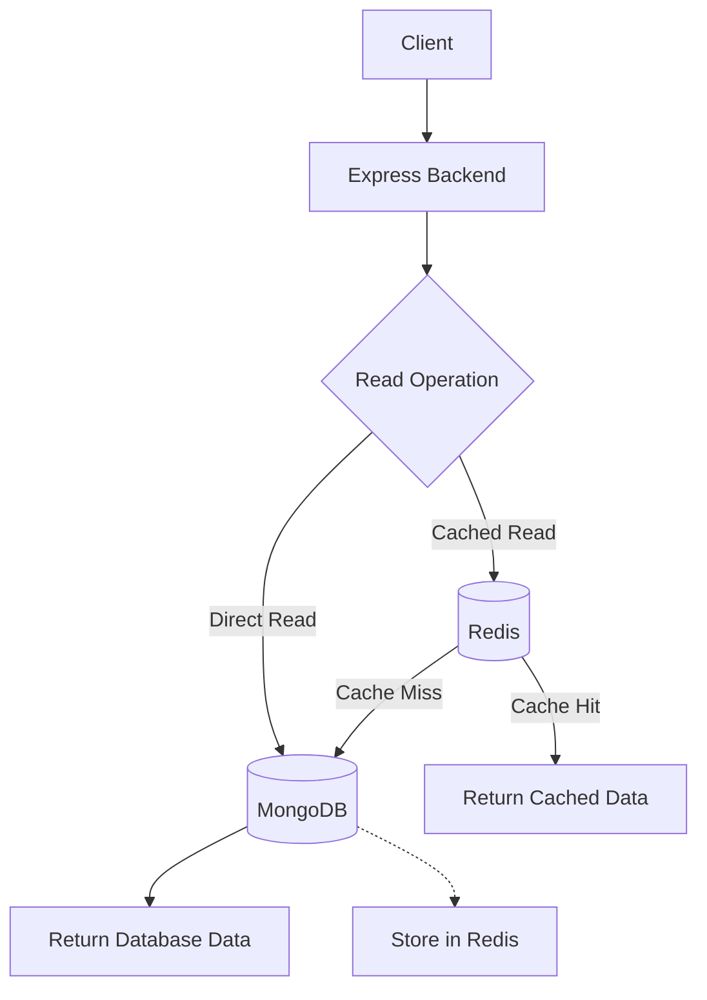

# MongoDB vs Redis — Caching (Cache-Aside Pattern)

A Node.js and Express project exploring Redis caching and comparing direct MongoDB reads with Redis-backed reads.

## Tech Stack

- Node.js & Express
- MongoDB — persistent data storage
- Redis & ioredis — in-memory caching
- Docker Compose — local service management

## Architecture



**Cache hit:** Requested data exists in Redis and can be returned without querying MongoDB.

**Cache miss:** Requested data is absent from Redis. In a cache-aside implementation, the backend fetches it from MongoDB and stores it in Redis for subsequent requests.

## Features

- Create users and store them in MongoDB.
- Fetch data directly from MongoDB.
- Fetch data using Redis.
- Explore cache hits, cache misses, and read performance.
- Run supporting services using Docker Compose.

## Setup

```bash
git clone <YOUR_REPOSITORY_URL>
cd <REPOSITORY_NAME>/level-2
npm install
```

Create a `.env` file using `.env.example` and configure your MongoDB connection and application settings.

Start the services defined in your Compose file:

```bash
docker compose up -d
```

Start the backend:

```bash
npm run dev
```

## Learning Goals

- Understand Redis caching and the cache-aside pattern.
- Compare direct database reads with cached reads.
- Explore Docker Compose and backend service integration.

## Future Improvements

- Add cache expiration (TTL) and invalidation.
- Benchmark response times under repeated requests.
