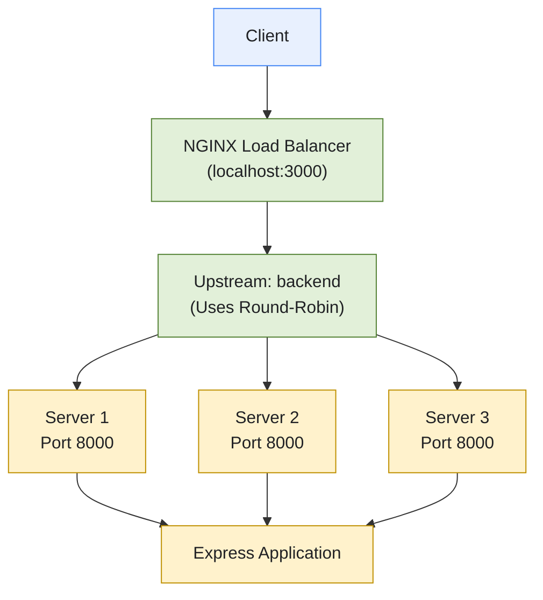

# NGINX Load Balancing & Horizontal Scaling

## Overview

This project demonstrates horizontal scaling of a Node.js and Express application using Docker Compose and NGINX as a reverse proxy and load balancer.

The application runs across three independent container instances. NGINX acts as the single entry point for incoming HTTP requests and distributes traffic across the configured backend instances using the round-robin algorithm.

The objective is to understand how multiple application instances can improve request-handling capacity and how load balancing supports scalable backend systems.

## Architecture



## Implementation

### 1. Application Containerization

A single Express application is built into a Docker image and used to run three independent containers:

- `server1`
- `server2`
- `server3`

Each container listens on port `8000` internally. The `SERVER_NAME` environment variable identifies the instance handling a request.

### 2. NGINX Configuration

NGINX defines an upstream group containing all three backend instances.

```nginx
events {}

http {
    upstream backend {
        server server1:8000;
        server server2:8000;
        server server3:8000;
    }

    server {
        listen 80;

        location / {
            proxy_pass http://backend;
        }
    }
}
```

NGINX uses round-robin load balancing by default when no alternative balancing method is configured. Requests are distributed across the available upstream servers.

The backend services are referenced by their Docker Compose service names and communicate over the Compose network.

### 3. Docker Compose

Docker Compose orchestrates the NGINX container and the three application containers.

The configured host ports are:

| Component | Host Port | Container Port |
|---|---:|---:|
| NGINX | 3000 | 80 |
| Server 1 | 3001 | 8000 |
| Server 2 | 3002 | 8000 |
| Server 3 | 3003 | 8000 |

Client requests should normally enter through NGINX at `http://localhost:3000`. Direct backend ports are useful for debugging and are optional.

## Getting Started

### Prerequisites

- Docker Desktop or another compatible Docker Engine
- Docker Compose
- Node.js and npm for running local load tests

### Start the Services

Run the following command from the directory containing `docker-compose.yml`:

```bash
docker compose up --build
```

## Load Testing

Autocannon is used to measure the application's request-handling performance through the NGINX entry point.

Install the server dependencies if they have not already been installed:

```bash
cd server
npm install
```

Run the benchmark while the Docker services are running:

```bash
npx autocannon -c 100 -d 30 http://localhost:3000
```

Parameters:

- `-c 100`: Use up to 100 concurrent connections.
- `-d 30`: Run the benchmark for 30 seconds.
- Target URL: Send traffic through NGINX rather than directly to a backend instance.

## Preliminary Benchmark Results

The following total request counts were observed during local testing:

| Backend Instances | Total Requests |
|---:|---:|
| 1 | 97,000 |
| 2 | 107,000 |
| 3 | 122,000 |

The observed results show increasing throughput as backend instances were added.

These figures are preliminary and should not be treated as a controlled performance benchmark. For a reliable comparison, run each configuration multiple times under identical conditions and compare requests per second, latency percentiles, and error rates. Local performance is also affected by CPU utilization, Docker overhead, and application workload.

## Key Concepts

- Horizontal scaling through multiple application instances
- Reverse proxying and request routing
- Round-robin load balancing
- Docker networking and service discovery
- Multi-container orchestration
- HTTP benchmarking and throughput measurement
- Performance comparison across different instance counts

## Configuration and Security

- Keep credentials and sensitive configuration in environment variables.
- Do not commit `.env` files containing secrets.
- Provide an `.env.example` file with placeholder values when configuration documentation is required.
- Avoid exposing backend ports publicly in production unless direct access is necessary.

## Shutdown

Stop the services and remove the containers created by Compose:

```bash
docker compose down
```

## Learning Outcome

Implemented a containerized backend architecture with multiple Express instances behind an NGINX load balancer. Verified round-robin request distribution and used Autocannon to compare request throughput across different instance counts.
